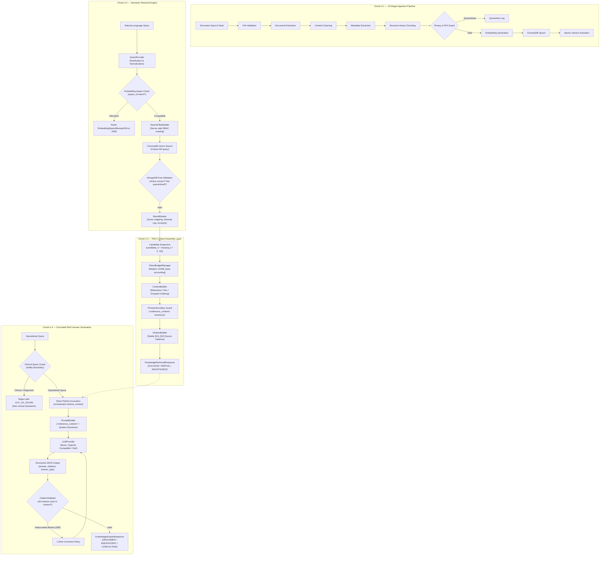
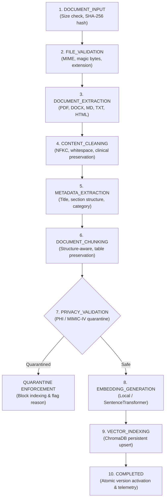

# HospitalOps AI — Hospital Knowledge, Retrieval & RAG Answer Generation (Chunks 4.1, 4.2, 4.3 & 4.4)

## Overview

The **Hospital Knowledge, Retrieval & RAG Subsystem** establishes an authoritative, privacy-preserving, and mathematically validated knowledge foundation for Retrieval-Augmented Generation (RAG) and operational decision intelligence.

In strict alignment with the **HospitalOps AI Constitution (`AGENTS.md`)**:
- The knowledge repository stores **operational guidelines, standard operating procedures (SOPs), clinical protocols, equipment manuals, and hospital policies**.
- It enforces a **Healthcare Data & Privacy Quarantine Boundary** that rejects and quarantines patient records or Protected Health Information (PHI) such as MRNs, SSNs, and MIMIC-IV clinical keys.
- Deterministic pipelines ensure that knowledge chunks maintain structural provenance, exact section paths, and parent-version integrity.
- Semantic vector retrieval enforces server-side role-based access classification (RBAC), embedding space compatibility validation, and post-retrieval verification against persistent storage.
- Context assembly packages retrieved knowledge into strict token budgets with prompt-safe boundary enclosures and deterministic source citations (`[S1]`, `[S2]`).
- Grounded answer generation synthesizes authoritative operational answers strictly grounded in retrieved evidence, enforces deterministic citation validation with 1-shot retry, screens clinical diagnostic queries (`OUT_OF_SCOPE`), and supports offline deterministic mock and OpenAI-compatible providers.

---

## Architecture Overview

---

## 10-Stage Ingestion Pipeline Architecture (Chunk 4.1)

### Stage Responsibilities:

1. **`DOCUMENT_INPUT`**: Validates file size against configurable limit (default: 25MB) and computes a SHA-256 content hash for deduplication.
2. **`FILE_VALIDATION`**: Checks file signature / magic bytes (`%PDF-` for PDF, `PK\x03\x04` for DOCX) and supported extensions (`.pdf`, `.docx`, `.txt`, `.md`, `.html`).
3. **`DOCUMENT_EXTRACTION`**: Extracts text page-by-page (PDF), preserves heading styles and converts tables to markdown (DOCX, HTML), or extracts clean text (MD, TXT). Detects scanned PDFs without extractable text and flags `requires_ocr`.
4. **`CONTENT_CLEANING`**: Applies Unicode NFKC normalization, strips redundant whitespace and newlines, while preserving medical notation (e.g., `SpO2: 98%`, `pH: 7.35-7.45`, `p < 0.05`, `ICU-A`).
5. **`METADATA_EXTRACTION`**: Extracts document title, structural outline, category, and access sensitivity classification.
6. **`DOCUMENT_CHUNKING`**: Structure-aware chunking respecting heading boundaries (`#`, `##`, `###`), paragraph breaks, and table atomicity. Configurable target tokens (default: 512) and sliding overlap (default: 64). Emits deterministic IDs (`{doc_id}_v{version}_c{idx}`).
7. **`PRIVACY_VALIDATION`**: Scans content for prohibited PHI (MRNs, SSNs, telephone numbers) and MIMIC-IV clinical dataset keys (`hadm_id`, `subject_id`, `stay_id`). Documents containing individual clinical data are rejected from vector indexing and placed into quarantine.
8. **`EMBEDDING_GENERATION`**: Generates 384-dimensional dense vectors using an abstract `EmbeddingProvider`. Defaults to `LocalDeterministicEmbedder` (fast, offline, L2-normalized) with support for `SentenceTransformerEmbedder` (`all-MiniLM-L6-v2`).
9. **`VECTOR_INDEXING`**: Persists chunk embeddings and rich metadata in an on-disk ChromaDB collection (`hospitalops_knowledge`). Performs idempotent upserts and version-isolated cleanups.
10. **`COMPLETED`**: Records stage execution times in `StageTelemetry`, creates an audit record, and atomically activates the new document version.

---

## Semantic Vector Retrieval Engine (Chunk 4.2)

### Core Components (`backend/app/knowledge/retrieval/`):

1. **`QueryEncoder`**:
   - Sanitizes and validates query strings ($1 \le L \le 500$ characters).
   - Generates unit-normalized dense vectors and verifies absence of non-finite float values (`NaN`, `Inf`).
   - Validates dimension against active embedder.

2. **Embedding Space Compatibility Verification**:
   - Embedding space identifier: `embedding_space_id = f"{provider}:{model}:d{dimension}:{metric}"`.
   - Before executing vector distance queries, `KnowledgeRetriever` verifies that the query embedding space strictly matches the stored ChromaDB collection metadata.
   - Prevents mathematically invalid cross-model distance comparisons (e.g. hashed n-grams vs. SentenceTransformer).

3. **Server-Side RBAC Filter Enforcement (`SearchFilterBuilder`)**:
   - Maps user authorization to ChromaDB metadata filters:
     - `Role.ADMIN`: All access classifications (`PUBLIC`, `INTERNAL`, `RESTRICTED`, `CONFIDENTIAL`).
     - `Role.OPERATIONS_MANAGER`: Operational access (`PUBLIC`, `INTERNAL`, `RESTRICTED`).
     - `Role.DOCTOR`: Standard staff access (`PUBLIC`, `INTERNAL`).
   - Rejects or clamps unauthorized client-requested access tiers.
   - Enforces department scoping and compound `$and` metadata filters.

4. **Repository Post-Validation**:
   - Verifies all candidate chunks against persistent MongoDB records.
   - Silently drops chunks belonging to quarantined, inactive, or superseded document versions.

5. **`ResultRanker` & Provenance**:
   - Maps raw cosine distance $d \in [0, 2]$ to normalized similarity score: $s = \max(0.0, \min(1.0, 1.0 - d))$.
   - Enforces diversity capping (`max_chunks_per_doc = 3`) to prevent a single document from dominating results.
   - Generates contextual content excerpts with sentence boundaries.
   - Emits structured provenance: chunk ID, document title, active version, section header, page marker, distance, and similarity percentage.

---

## Evaluation Benchmark & Retrieval Quality

Evaluated across an operational benchmark corpus:
- **Corpus**: ED Surge Protocol, Mechanical Ventilator SOP, Infection Control Guidelines.
- **Metrics Achieved**:
  - **Mean Reciprocal Rank (MRR)**: `1.0`
  - **Precision@1**: `1.0`
  - **Recall@3**: `1.0`

---

## RAG Context Retrieval & Assembly Layer (Chunk 4.3)

### Core Components (`backend/app/knowledge/retrieval/`):

1. **`TokenBudgetManager`**:
   - Manages token capacity limits (`max_context_tokens`, 200–16,000 tokens).
   - Accurately counts tokens offline using `tiktoken` (`cl100k_base`) with ratio-based fallback (`~1.33` tokens/word).
   - Reserves overhead for citation headers and formatting tags.
   - Greedily packs candidate chunks and records an explicit audit trail of skipped chunks (`SkippedChunkInfo`) with reasons (`token_budget_exceeded`).

2. **`CitationBuilder`**:
   - Assigns deterministic, sequential citation identifiers (`S1`, `S2`, ...).
   - Formats citation markers (`[S1]`, `[S2]`) and traceable source references incorporating document title, active version, section heading, and page number.
   - Calculates exact citation overhead tokens for budget management.

3. **`ContextBuilder`**:
   - Encloses reference passages in `<reference_content>` boundary tags with an explicit non-clinical operational notice.
   - Sanitizes closing tags (`</reference_content>` $\to$ `&lt;/reference_content&gt;`) to neutralize prompt injection attacks.
   - Supports three distinct ordering strategies:
     - `RELEVANCE`: Preserves descending semantic similarity ranking.
     - `DOCUMENT_ORDER`: Groups by document and orders chunks sequentially by `chunk_index` to maintain procedural flow.
     - `GROUPED_BY_DOC`: Groups chunks by document while prioritizing documents with highest peak similarity.

4. **`RetrievalContextOrchestrator`**:
   - Expands candidate pool ($k_{\text{cand}} = \max(\text{top\_k} \times 3, 15)$) to ensure rich selection.
   - Evaluates context grounding against calibrated minimum similarity thresholds ($s \ge 0.10$).
   - Categorizes execution status into explicit operational contracts:
     - `SUCCESS`: Relevant authorized chunks assembled within token budget.
     - `PARTIAL_CONTEXT`: Relevant candidate chunks exceeded token allowance and were omitted.
     - `INSUFFICIENT_CONTEXT`: Candidate chunks fell below minimum grounding threshold ($s < 0.10$).
     - `NO_RESULTS`: Zero authorized candidate chunks found.
     - `FAILED`: Internal decoding or retrieval failure.

---

## Grounded RAG Answer Generation (Chunk 4.4)

### Core Components (`backend/app/knowledge/generation/`):

1. **`KnowledgeAnswerService` & In-Memory Pipeline**:
   - Directly calls `RetrievalContextOrchestrator.retrieve_context` via Python in-memory invocation—zero HTTP loopbacks or serialization overhead.
   - Orchestrates clinical screening, retrieval execution, prompt construction, provider invocation, deterministic citation verification, and structured response assembly.

2. **Strict Healthcare Safety Boundary (`is_clinical_query`)**:
   - Evaluates user queries against pre-generation regex patterns detecting diagnostic inquiries, treatment prescriptions, and medication dosing.
   - Queries violating the clinical boundary are immediately short-circuited with `AnswerType.OUT_OF_SCOPE` and an authoritative non-clinical advisory disclaimer without invoking the LLM provider.

3. **Grounded Prompt Construction (`PromptBuilder`)**:
   - Wraps assembled reference text within `<reference_content>` boundary tags, neutralizing internal closing tags (`</reference_content>` $\to$ `&lt;/reference_content&gt;`).
   - Injects strict operational system instructions:
     - Cite exclusively using bracketed markers `[S1]`, `[S2]`.
     - Output answers in a structured JSON schema (`answer`, `answer_type`, `citations`, `limitations`).
     - Abstain with `INSUFFICIENT_EVIDENCE` if retrieved knowledge is lacking.
     - Disclose policy contradictions with `CONFLICTING_EVIDENCE`.

4. **Deterministic Citation Validation (`CitationValidator`) & 1-Shot Retry**:
   - Parses answer text for bracketed markers `[S\d+]`.
   - Cross-checks all cited markers against the valid citation set present in the assembled context.
   - If hallucinated citation markers (e.g., `[S99]`) or ungrounded assertions are detected, triggers a bounded 1-shot retry prompting the model to remove invalid markers.
   - If retry fails, automatically scrubs ungrounded citation tags from the final text.

5. **Pluggable LLM Provider Abstraction (`LLMProvider`)**:
   - `MockLLMProvider`: Deterministic, offline, keyword-synthesizing provider for CI, testing, and offline development.
   - `OpenAICompatibleProvider`: Async HTTP provider supporting OpenAI, vLLM, Ollama, and local OpenAI-compatible endpoints with timeout containment.
   - `NullLLMProvider`: Safe fallback when generative capabilities are disabled.

6. **Interactive RAG Answer Assistant (`frontend/src/pages/Knowledge/KnowledgeBase.tsx`)**:
   - 4th navigation tab providing an interactive chat-style operational QA interface.
   - Prominent non-clinical safety disclaimer banner.
   - Clickable citation pills `[S1]`, `[S2]` that scroll to and highlight cited source chunks.
   - Split evidence panel distinguishing chunks cited in the answer from other retrieved candidates.
   - Telemetry footer displaying model, provider, generation latency, retrieval time, tokens used, and prompt version.

---

## Document Categories & Access Levels

### Categories:
- `POLICY`: Hospital-wide administrative, governance, and operational policies.
- `SOP`: Standard Operating Procedures for clinical wards, triage, and staffing.
- `CLINICAL_PROTOCOL`: Evidence-based clinical guidelines and admission criteria.
- `EQUIPMENT_MANUAL`: Technical manuals for ventilators, dialysis machines, and concentrators.
- `INFECTION_CONTROL`: Disinfection, PPE, and isolation operational guidelines.
- `ADMINISTRATIVE`: Compliance, shift schedules, and resource dispatch protocols.
- `CAPACITY_PLANNING`: Surge criteria, overflow procedures, and bed allocation rules.
- `GENERAL_REFERENCE`: Reference dictionaries and operating glossaries.

### Access Levels:
- `PUBLIC`: Accessible to all hospital personnel.
- `INTERNAL`: Default operational level for care units and operations managers.
- `RESTRICTED`: Department leads, medical directors, and administrative supervisors.
- `CONFIDENTIAL`: Executive administration and regulatory review teams.

---

## REST API Specification

| Method | Endpoint | Permission | Description |
|---|---|---|---|
| `POST` | `/api/v1/knowledge/answer` | `knowledge.read` | Grounded operational question answering with citation validation & 1-shot retry |
| `GET` | `/api/v1/knowledge/answer/health` | `knowledge.read` | RAG answer generation readiness and active LLM provider diagnostics |
| `POST` | `/api/v1/knowledge/retrieve` | `knowledge.read` | Token-budget-aware RAG context assembly with citations & prompt-safe boundaries |
| `POST` | `/api/v1/knowledge/search` | `knowledge.read` | Natural-language semantic vector search with RBAC enforcement |
| `GET` | `/api/v1/knowledge/search/health` | `knowledge.read` | Retrieval readiness and embedding space diagnostics |
| `POST` | `/api/v1/knowledge/documents/upload` | `knowledge.manage` | Uploads multipart file and kicks off 10-stage ingestion |
| `GET` | `/api/v1/knowledge/documents` | `knowledge.read` | Lists documents with category, access level, and search filters |
| `GET` | `/api/v1/knowledge/documents/{id}` | `knowledge.read` | Retrieves document metadata, version history, and latest run telemetry |
| `GET` | `/api/v1/knowledge/documents/{id}/versions` | `knowledge.read` | Retrieves version history for a document |
| `GET` | `/api/v1/knowledge/documents/{id}/chunks` | `knowledge.read` | Inspects generated chunks with section titles and token counts |
| `POST` | `/api/v1/knowledge/documents/{id}/reindex` | `knowledge.manage` | Re-chunks and re-embeds document with custom token parameters |
| `DELETE` | `/api/v1/knowledge/documents/{id}` | `knowledge.manage` | Permanently deletes document, file archive, and vector indices |
| `GET` | `/api/v1/knowledge/ingestion-runs` | `knowledge.read` | Lists historical ingestion runs and stage execution metrics |
| `GET` | `/api/v1/knowledge/stats` | `knowledge.read` | Retrieves total documents, chunks, tokens, and storage metrics |
| `GET` | `/api/v1/knowledge/categories` | `knowledge.read` | Retrieves metadata options for categories and access levels |
